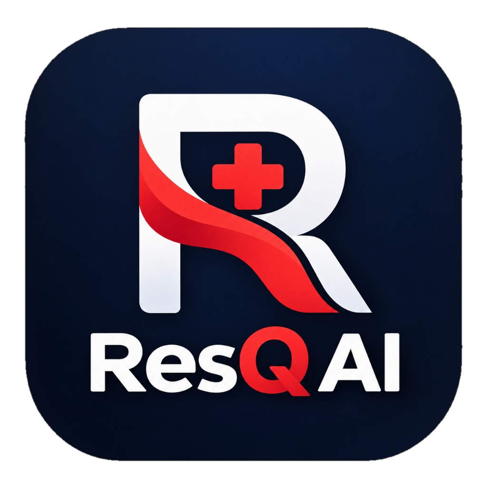
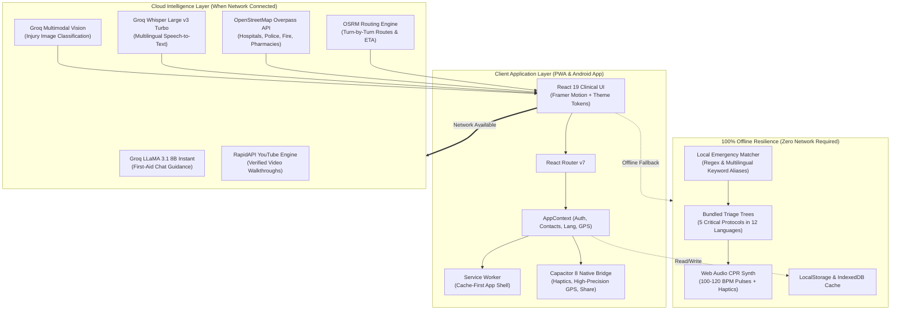

<div align="center">

  

  # ResQ AI — Emergency First-Response System

  **AI-powered emergency first-response in your language. Works 100% offline.**  
  *One-tap SOS dispatch, offline decision trees, CPR metronome, multimodal AI triage, and live nearby routing.*

  <br />

  [](https://resq-ai-three.vercel.app/)
  [](https://react.dev/)
  [](https://capacitorjs.com/)
  [](https://web.dev/progressive-web-apps/)
  [](https://groq.com/)
  [](https://github.com/nabeel05-ship-it/ResQ-AI)
  [](https://jestjs.io/)
  [](LICENSE)

  <br />

  ### 🚀 **[Try the Live Web Application: resq-ai-three.vercel.app](https://resq-ai-three.vercel.app/)**

  <br />

  [Live Demo](https://resq-ai-three.vercel.app/) •
  [Key Features](#-key-features) •
  [Live Demo Flow](#-90-second-demo-walkthrough) •
  [Architecture](#-system-architecture) •
  [Quickstart (Web)](#-quickstart-web) •
  [Android App](#-mobile-app-android-via-capacitor) •
  [API & Environment](#-environment-configuration)

</div>

---

## 📌 Table of Contents

- [Live Deployment (Vercel)](#-live-deployment-vercel)
- [The Problem We Solve](#-the-problem-we-solve)
- [Key Features](#-key-features)
- [Supported Languages (12+)](#-supported-languages-12)
- [System Architecture](#-system-architecture)
- [Quickstart (Web)](#-quickstart-web)
  - [Prerequisites](#prerequisites)
  - [Installation & Local Dev](#installation--local-dev)
  - [Environment Configuration](#-environment-configuration)
  - [Production PWA & Offline Testing](#production-pwa--offline-testing)
- [Mobile App (Android via Capacitor)](#-mobile-app-android-via-capacitor)
  - [Prerequisites](#prerequisites-1)
  - [Sync & Build APK](#sync--build-apk)
  - [Native Device Capabilities](#native-device-capabilities)
- [90-Second Demo Walkthrough](#-90-second-demo-walkthrough)
- [Project Structure](#-project-structure)
- [Quality Assurance & Automated Tests](#-quality-assurance--automated-tests)
- [Post-Hackathon Roadmap](#-post-hackathon-roadmap)
- [Medical Disclaimer](#-medical-disclaimer)
- [License](#-license)

---

## 🚀 Live Deployment (Vercel)

ResQ AI is deployed and live in production on **Vercel**:

> 🔗 **Production URL:** [https://resq-ai-three.vercel.app/](https://resq-ai-three.vercel.app/)

### 🌟 Instant Evaluator Testing
- **1-Click Demo Evaluation:** Click **"Demo Login (Dhruv)"** on the login screen to enter the emergency response dashboard with pre-configured emergency contacts and profile state.
- **Installable PWA Experience:** Open the link on Google Chrome, Edge, or mobile Safari and select **"Add to Home Screen"** or **"Install App"** to install the application locally.
- **Test 100% Offline Resilience:** After loading the page, disconnect your Wi-Fi or toggle **Airplane Mode**: the bundled clinical decision trees, CPR metronome, multilingual translations, and offline keyword matcher remain 100% functional.

---

## 🚨 The Problem We Solve

In India and many developing nations, the average emergency ambulance response time in metropolitan centers ranges from **25 to 30 minutes**, while rural and semi-urban delays frequently **exceed an hour**. 

For critical emergencies such as **cardiac arrest**, **severe trauma**, or **airway obstruction**:
- **Every minute without intervention reduces survival rates by ~10%**.
- Permanent brain death begins within **4 to 6 minutes** of oxygen deprivation.
- The decisive first 5 minutes are almost always managed by a panicked bystander or family member with **zero medical training** and **limited English fluency**.
- Network dead zones, natural disasters, remote highways, and overloaded cellular towers often make cloud-dependent healthcare apps completely **unusable** when every second counts.

**ResQ AI** solves this critical gap. It puts an intuitive, clinical-grade first-aid guide in every citizen's pocket—engineered from the ground up to **work completely offline**, speak **12 native languages**, and trigger life-saving location dispatches in seconds.

---

## ⚡ Key Features

| Capability | Technical Implementation | Impact / Value |
|---|---|---|
| 🆘 **Hold-to-SOS Dispatch** | 2-second hold trigger with visual progress radial, countdown vibration, and dual Web/Capacitor GPS capture | Prevents accidental pocket triggers; instantly packages live Google Maps coordinates + emergency type for WhatsApp, SMS, or native share. |
| 📴 **100% Offline Decision Trees** | American Heart Association & Red Cross-aligned decision trees bundled into client state (`src/data/triageTrees.js`) | 5 high-lethality scenarios (Heart Attack, Choking, Severe Bleeding, Burns, Unconsciousness) render with **zero network connectivity**. |
| 🥁 **CPR Audio/Haptic Metronome** | Web Audio API synthesizer pulse generator calibrated to 100–120 BPM with synchronized device haptics | Guides rescuer chest compression frequency directly on-screen during cardiac arrest and unconsciousness protocols. |
| 🛡️ **Offline Emergency Matcher** | Local fuzzy keyword and alias detection across English, Hindi, and Hinglish / Romanized phrases | If the user is offline or the LLM API is unavailable, queries immediately map to structured local triage guides with zero latency. |
| 🤖 **Multimodal AI Guidance** | Groq-accelerated LLaMA 3.1 8B Instant chat engine with emergency prompt guardrails and conversational history | Provides adaptive, conversational first-responder advice when internet connectivity is active. |
| 📷 **Camera & Vision Triage** | Multimodal image classification powered by Groq vision endpoints (`qwen/qwen3.8-27b` / LLaMA 3.2 Vision) | Bystanders snap or upload injury photos; vision AI grades trauma severity, flags critical symptoms, and routes directly to triage guides. |
| 🎙️ **Voice Input & Whisper STT** | Push-to-talk audio streaming transcribed via Groq Whisper Large v3 Turbo + Web Speech API fallback | Enables hands-free emergency communication for injured or panicked users across Indian languages, with optional voice audio readouts. |
| 📍 **Nearby Facilities & Routing** | Live OpenStreetMap Overpass queries with 5 km radius + Leaflet map with OSRM turn-by-turn routing | Dynamically locates Hospitals, Emergency Clinics, Pharmacies, Police, and Fire Stations with driving/walking times and curated offline presets. |
| 📺 **Verified Video Tutorials** | RapidAPI YouTube client with automated medical query normalization (`queryExtract.js`) | Delivers concise, verified medical video walkthroughs tailored to the user's specific emergency context. |
| ⚡ **1-Click Demo Profile** | Pre-configured evaluator account ("Dhruv") pre-loaded with emergency contacts and localized profile state | Allows judges and evaluators to test complete SOS dispatch and auth flows instantly without manual signup. |
| 📱 **Dual Delivery (PWA + APK)** | Service Worker cache-first architecture + Capacitor 8 Android native wrapper with high-accuracy GPS | Runs seamlessly across any modern web browser, desktop, iOS Safari, or installable Android APK. |

---

## 🌐 Supported Languages (12+)

ResQ AI features a native internationalization engine supporting **12 languages** across all core screens, emergency decision trees, navigation menus, and AI responses. The language modal allows instantaneous switching with immediate persistence:

| Language | Native Name | Script Code | Direction | Localized Triage Support |
|---|---|:---:|:---:|:---:|
| **English** | English | `EN` | LTR | ✅ Fully Localized |
| **Hindi** | हिन्दी | `हिं` | LTR | ✅ Fully Localized |
| **Kannada** | ಕನ್ನಡ | `ಕ` | LTR | ✅ Fully Localized |
| **Tamil** | தமிழ் | `த` | LTR | ✅ Fully Localized |
| **Telugu** | తెలుగు | `తె` | LTR | ✅ Fully Localized |
| **Malayalam** | മലയാളം | `മ` | LTR | ✅ Fully Localized |
| **Marathi** | मराठी | `म` | LTR | ✅ Fully Localized |
| **Bengali** | বাংলা | `বা` | LTR | ✅ Fully Localized |
| **Gujarati** | ગુજરાતી | `ગુ` | LTR | ✅ Fully Localized |
| **Punjabi** | ਪੰਜਾਬੀ | `ਪੰ` | LTR | ✅ Fully Localized |
| **Odia** | ଓଡ଼ିଆ | `ଓ` | LTR | ✅ Fully Localized |
| **Urdu** | اردو | `اُر` | RTL | ✅ Fully Localized (RTL) |

---

## 🏗️ System Architecture



---

## 💻 Quickstart (Web)

### Prerequisites
- **Node.js**: v18.0.0 or higher
- **npm**: v9.0.0 or higher

### Installation & Local Dev

```bash
# 1. Clone the repository
git clone https://github.com/nabeel05-ship-it/ResQ-AI.git
cd ResQ-AI

# 2. Install dependencies
npm install

# 3. Create your local environment file
cp .env.example .env.local

# 4. Start the development server
npm start
```

The application will launch automatically at `http://localhost:3000`.

---

### 🔑 Environment Configuration

ResQ AI uses Create React App conventions. Variables must be prefixed with `REACT_APP_` to be included in the client bundle. Populate `.env.local` with your keys:

| Variable Name | Status | Purpose & Provider |
|---|:---:|---|
| `REACT_APP_GROQ_API_KEY` | **Recommended** | Powers LLaMA 3.1 8B chat, Qwen/LLaMA vision triage, and Whisper v3 Turbo STT. Obtain a key at [Groq Console](https://console.groq.com/keys). |
| `REACT_APP_RAPIDAPI_KEY` | *Optional* | Powers first-aid video walkthrough retrieval in `RelatedVideos.js`. Obtain a key at [RapidAPI](https://rapidapi.com). |
| `REACT_APP_RAPIDAPI_HOST` | *Optional* | RapidAPI host endpoint (`youtube-v2.p.rapidapi.com` or `youtube-v31.p.rapidapi.com`). Defaults to `youtube-v2.p.rapidapi.com`. |

> [!NOTE]
> **Graceful Offline Fallback**: If `REACT_APP_GROQ_API_KEY` is not provided or the user goes offline, ResQ AI automatically shifts to its **Offline Emergency Matcher** and bundled triage trees. The application never crashes due to missing keys.

---

### Production PWA & Offline Testing

To test the cache-first Service Worker and offline capabilities:

```bash
# 1. Build the optimized production bundle
npm run build

# 2. Serve the build locally
npx serve -s build
```

1. Open `http://localhost:3000` in Google Chrome or Chromium.
2. Open **DevTools** (`F12`) → **Application** → **Service Workers**.
3. Verify the Service Worker is **Active and Running**.
4. Check **Offline** (simulate zero network connectivity).
5. Refresh the page: the entire app shell, icons, decision trees, and language assets load instantly.

---

## 📱 Mobile App (Android via Capacitor)

ResQ AI includes a production-ready Android wrapper built with **Capacitor 8**. The native build leverages hardware features (high-accuracy GPS, haptic vibration engines, and the system share sheet) while reusing 100% of the React code.

### Prerequisites
- **Android Studio** (Hedgehog / Iguana / Ladybug or newer)
- **Android SDK & Build Tools** (API 34+)
- **JDK 17+** (bundled with Android Studio)
- Connected Android physical device or virtual emulator (AVD)

### Sync & Build APK

```bash
# Sync web build to the native Android directory
npm run android:sync

# Open project in Android Studio
npm run android:open
```

To compile a shareable debug APK directly from the CLI:

```bash
cd android
./gradlew assembleDebug
```

The generated APK will be available at:
`android/app/build/outputs/apk/debug/app-debug.apk`

---

### Native Device Capabilities

| Capability | Browser Fallback | Native Android (Capacitor) |
|---|---|---|
| **SOS Haptic Feedback** | `navigator.vibrate` (basic) | `Capacitor Haptics`: Light pulse during hold + Success notification vibration |
| **Location Precision** | Browser Geolocation API | `Capacitor Geolocation`: Direct hardware GPS lock with high accuracy |
| **SOS Message Dispatch** | Direct `wa.me` deep link | Native System Share Sheet (WhatsApp, SMS, Telegram, Gmail, Emergency Contacts) |
| **App Branding & Windowing** | Browser chrome / URL bar | Custom branded dark splash screen (`#0b1220`) and translucent status bar |
| **Triage Storage** | Service Worker cache | Pre-bundled assets inside APK assets directory |
| **Hardware Permissions** | Browser permission popups | Android Manifest declarations: `INTERNET`, `ACCESS_FINE_LOCATION`, `VIBRATE`, `CAMERA`, `RECORD_AUDIO` |

---

## ⏱️ 90-Second Demo Walkthrough

Follow this step-by-step evaluation script to test all core features in under 90 seconds:

```
[00:00 - 00:15] 1-CLICK DEMO AUTH
  1. Open https://resq-ai-three.vercel.app/ (or http://localhost:3000 locally)
  2. Click "Demo Login (Dhruv)" — instantly bypasses credentials into the emergency hub.
  3. Pre-loaded emergency contacts and default preferences populate immediately.

[00:15 - 00:30] OFFLINE RESILIENCE
  4. Open DevTools (F12) → Network tab → toggle "Offline" (or turn on Airplane Mode).
  5. On the homepage, tap the "Heart Attack / Cardiac Arrest" guide.
  6. Notice the guide loads with zero latency.
  7. Tap "Start Metronome" — hear and feel the rhythmic 100 BPM chest compression beat.

[00:30 - 00:45] MULTILINGUAL SWITCHING
  8. Click the Language icon (🌐) in the header.
  9. Click "हिन्दी" (Hindi) or "தமிழ்" (Tamil).
  10. The UI, triage trees, red flags, and quick calls update immediately without page reload.

[00:45 - 01:05] HOLD-TO-SOS DISPATCH
  11. Go back to Home. Press and hold the glowing red "Hold for SOS" button for 2 seconds.
  12. Observe the radial countdown ring and haptic pulses.
  13. Release upon completion — live GPS coordinates and Google Maps link are dispatched to pre-saved contacts.

[01:05 - 01:30] AI VISION & NEARBY ROUTING (Toggle Online)
  14. Turn network connectivity back on.
  15. Tap "Ask AI" → Upload or take a sample photo (e.g. burn or sprain).
  16. The Groq vision model classifies the injury severity and renders immediate steps.
  17. Navigate to "Nearby" → Observe live hospitals on the Leaflet map with OSRM turn-by-turn routes.
```

---

## 📂 Project Structure

```
ResQ-AI/
├── .env.example                 # Documented template for environment variables
├── .env.local                   # Local credentials (ignored by Git)
├── capacitor.config.json        # Capacitor 8 native Android application configuration
├── package.json                 # Project dependencies, scripts, and testing configs
├── android/                     # Native Android Studio project & Gradle build files
├── public/
│   ├── assets/
│   │   ├── resq-ai-logo.png     # Official high-resolution ResQ AI brand logo
│   │   └── resq-ai-emblem.png   # Shield & heartbeat emblem
│   ├── manifest.json            # Progressive Web App manifest
│   └── service-worker.js        # Cache-first service worker for offline execution
└── src/
    ├── App.js                   # Application root, routing configuration & auth guard
    ├── App.test.js              # Integration tests for auth, branding, and footer
    ├── index.js                 # Entry point & PWA service worker registration
    ├── theme.js                 # Clinical design tokens (colors, typography, radii)
    ├── components/
    │   ├── AppShell.js          # Responsive navigation shell & header bar
    │   ├── BrandLogo.js         # Standardized brand logo component (variants & fallbacks)
    │   ├── SOSButton.js         # 2-second hold-to-SOS trigger + contact manager modal
    │   ├── LangPickerModal.js   # Fast single-click 12-language switcher modal
    │   ├── LeafletMap.js        # Interactive OpenStreetMap canvas with route polyline
    │   ├── LocationMap.js       # Lightweight coordinate preview map
    │   ├── RelatedVideos.js     # First-aid YouTube video carousel & embedded player
    │   └── AIGuide.js           # Multi-turn emergency guidance dialogue walkthrough
    ├── context/
    │   └── AppContext.js        # Global state (auth user, single language, contacts, GPS)
    ├── data/
    │   ├── emergencyData.js     # Quick numbers (112, 102, 101, 100) & subcategories
    │   └── triageTrees.js       # Bundled clinical triage decision trees across 12 languages
    ├── i18n/
    │   ├── translations.js      # Complete multilingual dictionaries (8 namespaces)
    │   ├── translations.test.js # Test suite for 12 languages, scripts, and RTL
    │   └── raw_translations.json# Raw localized JSON dictionaries
    ├── pages/
    │   ├── Login.js             # Email/Password + 1-Click Demo Login screen
    │   ├── Home.js              # Emergency command hub, quick calls, offline guides
    │   ├── Triage.js            # Step-by-step offline decision trees + CPR metronome
    │   ├── Guidance.js          # Groq AI chat, vision image triage & voice STT
    │   └── Nearby.js            # Overpass API nearby medical places + OSRM directions
    └── utils/
        ├── detectEmergency.js   # Offline multilingual keyword & alias emergency matcher
        ├── groqVision.js        # Groq vision model classifier & image payload handler
        ├── groqAudio.js         # Groq Whisper Large v3 Turbo audio transcription client
        ├── places.js            # Overpass API place queries (hospitals, police, clinics)
        ├── routing.js           # OSRM turn-by-turn driving, walking & cycling routes
        ├── recorder.js          # MediaRecorder audio streaming with audio level meter
        ├── speech.js            # Web Speech API text-to-speech voice synthesizer
        ├── queryExtract.js      # Emergency query cleaner for tutorial video search
        └── native.js            # Capacitor native hardware bridges (GPS, Haptics, Share)
```

---

## 🧪 Quality Assurance & Automated Tests

ResQ AI maintains an automated test suite powered by **Jest** and **React Testing Library** verifying all critical paths, brand elements, and internationalization logic:

```bash
# Run the complete test suite
npm test -- --watchAll=false
```

```
PASS src/i18n/translations.test.js
  ✓ all 12 advertised languages are defined with native script identifiers
  ✓ every language dictionary has all 8 core namespaces
  ✓ emergency triage trees provide localized content across all 12 languages
  ✓ deep merge fallback returns English value if language has missing field
  ✓ clicking a language in modal immediately switches single active language
  ✓ switching to Kannada inside AppShell updates navigation tabs immediately
  ✓ Urdu language sets document direction to rtl

PASS src/App.test.js
  ✓ renders ResQ AI application and authentication screen
  ✓ renders demo login button with username Dhruv
  ✓ clicking demo login button logs in with username Dhruv
  ✓ renders official ResQ AI brand logo image
  ✓ footer tagline on homepage does not repeat ResQ AI

Test Suites: 2 passed, 2 total
Tests:       12 passed, 12 total
Snapshots:   0 total
Time:        1.45 s
```

---

## 🗺️ Post-Hackathon Roadmap

- [ ] **Secure Cloud API Proxy**: Transition client-side Groq and RapidAPI calls through a serverless proxy (Cloudflare Workers / Vercel Edge) to protect credentials in production.
- [ ] **Persistent Firebase / Supabase Auth**: Upgrade client-side demo state to end-to-end encrypted cloud authentication with multi-device synchronization.
- [ ] **Continuous Wake-Word Detection**: Hands-free background listening for high-stress keywords (e.g., *"Hey ResQ, help!"* or *"Chest pain"*).
- [ ] **Family / Caregiver Incident Mesh**: Webhook-based multi-recipient push alerts dispatched to family members during active SOS triggers.
- [ ] **Crowdsourced Civil Defense Layer**: Live hazard and disaster map layer indicating waterlogging, roadblocks, and medical supply shortages.
- [ ] **Expanded Offline Triage Protocols**: Additional clinical trees for Snake Bites, Electric Shock, Stroke (FAST Protocol), Heatstroke, and Pediatric Seizures.

---

## ⚠️ Medical Disclaimer

> **Important Notice:** ResQ AI is an informational **first-response bystander aid**, designed to assist non-professionals during the critical minutes before emergency services arrive. It is **not** a diagnostic device, certified medical software, or a replacement for professional clinical care. Always contact official emergency services (**112** in India, **911** in the US, **999** in the UK) immediately during any medical or life-threatening situation.

---

## 📄 License

This project was built for hackathon demonstration purposes under the **MIT License**. See the [LICENSE](LICENSE) file for more details.

---

<div align="center">
  <sub>Built with ❤️ to protect lives during the Golden Hour.</sub>
</div>
